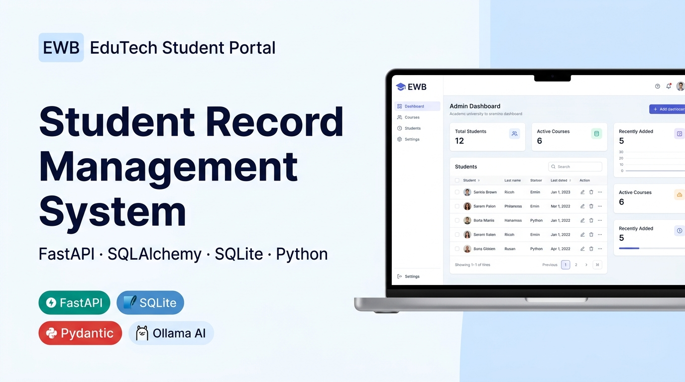
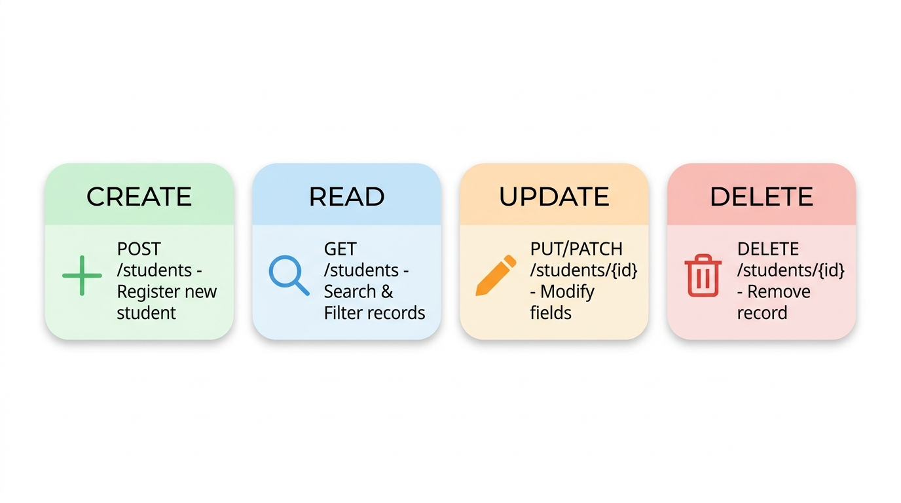

# Student Record Management System

<div align="center">

  

  <br/><br/>

  
  
  
  
  
  
  
  

  <br/>

  > **Production-grade Student Record Management System** built for the EWB Edu Tech Pvt. Ltd. internship assignment.  
  > Full-stack CRUD · Persistent SQLite · Pydantic v2 · Responsive Dashboard · Optional Local AI

</div>

---

## 📋 Table of Contents

1. [Project Overview](#1-project-overview)
2. [Project Objective](#2-project-objective)
3. [Key Features](#3-key-features)
4. [Technology Stack](#4-technology-stack)
5. [Architecture & Request Flow](#5-architecture--request-flow)
6. [Project Structure](#6-project-structure)
7. [Understanding CRUD Operations](#7-understanding-crud-operations)
8. [Prerequisites](#8-prerequisites)
9. [Windows Installation](#9-windows-installation-instructions)
10. [Application Startup](#10-application-startup-instructions)
11. [Local Database Behavior](#11-local-database-behavior--location)
12. [API Endpoint Reference](#12-api-endpoint-reference)
13. [Example JSON Requests & Responses](#13-example-json-requests--responses)
14. [Interactive API Testing (`/docs`)](#14-interactive-api-testing-using-docs)
15. [Automated Testing Suite](#15-automated-testing-instructions)
16. [Sample Data Seeding](#16-sample-data-instructions)
17. [Optional AI Assistant (Ollama)](#17-optional-local-ai-assistant-using-ollama)
18. [Troubleshooting](#18-troubleshooting)
19. [Security & Privacy Notes](#19-security-and-privacy-notes)
20. [GitHub Submission Checklist](#20-github-submission-checklist--git-commands)
21. [License](#21-license)

---

## 1. Project Overview

**Student Record Management System** is a reliable, scalable academic administration web application providing end-to-end management of student lifecycle records.

Features strict data validation, relational persistence in SQLite, an interactive administrative frontend, and safe natural-language querying via local LLMs — all with zero external cloud dependencies for core functionality.

---

## 2. Project Objective

Build an industry-standard student record management solution that:

- ✅ Implements robust **Create, Read, Update, and Delete (CRUD)** operations.
- ✅ Persists all data reliably in a **local SQLite database** across restarts.
- ✅ Enforces **strict data sanitization** and schema validation using Pydantic and SQLAlchemy.
- ✅ Provides an **intuitive, responsive** administrative web interface.
- ✅ Integrates an **optional local AI assistant** using Ollama with strict context grounding.

---

## 3. Key Features

- 📋 **Full Lifecycle Student CRUD** — Create, view, edit, delete with unique IDs, all fields, two-step delete confirmation.
- 🔍 **Real-time Search & Filtering** — Debounced case-insensitive name search, course filter dropdown, items-per-page selector.
- 📊 **Live Dashboard Statistics** — Total students, active courses, recent additions, course distribution badges.
- ✉️ **Strict Validation Rules** — At least one contact method required; email uniqueness enforced; date and format checks.
- 🤖 **Optional Local AI Assistant** — Grounded natural-language queries on student data via Ollama with offline fallback.
- 🧪 **25 Automated Tests** — Complete pytest suite covering CRUD, validation, pagination, and AI endpoints.
- 🔒 **Security Controls** — Pydantic validation, ORM-only queries, security headers, no secrets in Git.

---

## 4. Technology Stack

| Layer | Technology | Purpose |
|---|---|---|
| **Backend** | FastAPI (Python 3.11+) | Async REST API, routing, request validation |
| **ORM** | SQLAlchemy 2.0 | Parameterized queries, relational models |
| **Validation** | Pydantic v2 + `email-validator` | Strict sanitization, field rules, contact policy |
| **Database** | SQLite 3 | Project-relative persistent relational storage |
| **Frontend** | HTML5, Vanilla CSS3, ES6 JS | Responsive admin dashboard, modals, toasts |
| **Templating** | Jinja2 | Dashboard rendering from FastAPI |
| **AI (Optional)** | Ollama (`llama3.2:1b`) | Grounded natural language query engine |
| **Testing** | Pytest + HTTPX TestClient | Automated CRUD, edge case, and AI mock testing |
| **Server** | Uvicorn | Production ASGI HTTP application server |

---

## 5. Architecture & Request Flow

```
┌─────────────────────┐
│  Web Browser        │  HTML5 · Vanilla CSS · ES6 JS
│  (Admin Dashboard)  │
└────────┬────────────┘
         │  HTTP JSON (Fetch API)
         ▼
┌─────────────────────┐
│  FastAPI Application│  Security Headers · CORS · Lifespan
│  (app/main.py)      │
└──────┬──────────────┘
       │                    ┌──────────────────────┐
  /students (CRUD)          │  Optional Ollama AI   │
       │               ──►  │  (llama3.2:1b local)  │
       ▼                    └──────────────────────┘
┌─────────────────────┐
│  Pydantic v2        │  Validation · Sanitization · Rules
│  (app/schemas.py)   │
└────────┬────────────┘
         ▼
┌─────────────────────┐
│  SQLAlchemy ORM     │  Parameterized queries · Transactions
│  (app/crud.py)      │
└────────┬────────────┘
         ▼
┌─────────────────────┐
│  SQLite Database    │  Persistent · Project-relative path
│  (students.db)      │
└─────────────────────┘
```

---

## 6. Project Structure

```
student-record-management/
├── app/
│   ├── __init__.py
│   ├── config.py              ← Settings, project-relative DB path, Ollama config
│   ├── database.py            ← SQLAlchemy engine, session factory, get_db
│   ├── models.py              ← Student ORM model with audit timestamps
│   ├── schemas.py             ← Pydantic v2 request/response schemas & validators
│   ├── crud.py                ← Parameterized DB operations & business logic
│   ├── routers/
│   │   ├── students.py        ← REST API: CRUD endpoints + stats + courses
│   │   └── ai.py              ← AI Assistant: /ai/ask and /ai/status
│   ├── services/
│   │   └── ollama_service.py  ← Safe Ollama integration & grounded response
│   ├── templates/
│   │   └── index.html         ← Administrative SPA dashboard template
│   └── static/
│       ├── css/style.css      ← Academic admin design system
│       └── js/app.js          ← CRUD modals, search, pagination, toasts
├── docs/
│   ├── readme_banner.jpg      ← Hero banner image
│   └── readme_crud.jpg        ← CRUD operations infographic
├── tests/
│   ├── conftest.py            ← Isolated test SQLite fixture & TestClient
│   ├── test_students.py       ← 20 CRUD + validation + persistence tests
│   └── test_ai.py             ← 5 AI tests with mocked Ollama responses
├── seed_data.py               ← Populate 12 fictional demo student records
├── run.py                     ← Application launcher with uvicorn
├── requirements.txt           ← All Python dependencies
├── .env.example               ← Environment configuration template
├── .gitignore                 ← Excludes DB, venv, caches, secrets
├── LICENSE                    ← MIT License
└── README.md                  ← This file
```

---

## 7. Understanding CRUD Operations

<div align="center">
  
</div>

<br/>

| Operation | HTTP Method | Endpoint | Description | Status |
|---|---|---|---|---|
| 🟢 **Create** | `POST` | `/students` | Register a new student with validated data | `201 Created` |
| 🔵 **Read (List)** | `GET` | `/students` | Browse, search, filter, and paginate records | `200 OK` |
| 🔵 **Read (One)** | `GET` | `/students/{id}` | Fetch a single student profile by ID | `200 OK` / `404` |
| 🟡 **Update (Full)** | `PUT` | `/students/{id}` | Replace all fields while preserving the original ID | `200 OK` |
| 🟡 **Update (Partial)** | `PATCH` | `/students/{id}` | Modify only supplied fields; omitted fields remain unchanged | `200 OK` |
| 🔴 **Delete** | `DELETE` | `/students/{id}` | Permanently remove the student record from SQLite | `204 No Content` |

---

## 8. Prerequisites

- **Python 3.10+** (tested on Python 3.11.9)
- **Git** installed on Windows
- **PowerShell** or Command Prompt
- *(Optional)*: [Ollama](https://ollama.com/) for local AI features

---

## 9. Windows Installation Instructions

```powershell
# 1. Navigate to project directory
cd "d:\current project\future AI agent\rw"

# 2. Create virtual environment
python -m venv .venv

# 3. Activate virtual environment
.venv\Scripts\Activate.ps1

# 4. Install dependencies
python -m pip install --upgrade pip
python -m pip install -r requirements.txt
```

> ⚠️ If PowerShell execution is restricted: `Set-ExecutionPolicy -Scope Process -ExecutionPolicy Bypass`

---

## 10. Application Startup Instructions

### Option A: Launcher Script (Recommended)
```powershell
python run.py
```

### Option B: Uvicorn Directly
```powershell
python -m uvicorn app.main:app --host 127.0.0.1 --port 8000 --reload
```

| URL | Description |
|---|---|
| 🌐 [http://127.0.0.1:8000](http://127.0.0.1:8000) | **Administrative Dashboard** |
| 📖 [http://127.0.0.1:8000/docs](http://127.0.0.1:8000/docs) | **Swagger UI (Interactive API Docs)** |
| 📚 [http://127.0.0.1:8000/redoc](http://127.0.0.1:8000/redoc) | **ReDoc API Reference** |
| 💚 [http://127.0.0.1:8000/health](http://127.0.0.1:8000/health) | **Health Check** |

---

## 11. Local Database Behavior & Location

- **Engine**: SQLite 3 via SQLAlchemy ORM with foreign keys enabled
- **File Location**: `./students.db` (project-relative, auto-created on startup)
- **Persistence**: All data persists across server restarts
- **Git Safety**: `*.db` files are excluded by `.gitignore`

---

## 12. API Endpoint Reference

| Method | Endpoint | Description | Status Code |
|---|---|---|---|
| `POST` | `/students` | Create new student record | `201 Created` |
| `GET` | `/students` | List students with search, filter, pagination | `200 OK` |
| `GET` | `/students/stats/summary` | Live aggregate statistics & course breakdown | `200 OK` |
| `GET` | `/students/courses` | Distinct active course names | `200 OK` |
| `GET` | `/students/{id}` | Retrieve single student by ID | `200 OK` / `404` |
| `PUT` | `/students/{id}` | Full replacement update (preserve ID) | `200 OK` / `404` / `400` |
| `PATCH` | `/students/{id}` | Partial update of provided fields | `200 OK` / `404` / `422` |
| `DELETE` | `/students/{id}` | Permanently delete student record | `204 No Content` / `404` |
| `POST` | `/ai/ask` | Safe grounded natural-language query | `200 OK` |
| `GET` | `/ai/status` | Check Ollama daemon connectivity | `200 OK` |
| `GET` | `/health` | API health check | `200 OK` |

---

## 13. Example JSON Requests & Responses

### Create Student (`POST /students`)

**Request:**
```json
{
  "name": "Eleanor Vance",
  "date_of_birth": "2003-04-15",
  "email": "eleanor.vance@example.edu",
  "phone": "+1-555-0101",
  "course": "Computer Science",
  "address": "404 Logic Gate Way, Silicon Valley, CA",
  "enrollment_date": "2022-09-01"
}
```

**Response `201 Created`:**
```json
{
  "id": 1,
  "name": "Eleanor Vance",
  "date_of_birth": "2003-04-15",
  "email": "eleanor.vance@example.edu",
  "phone": "+1-555-0101",
  "course": "Computer Science",
  "address": "404 Logic Gate Way, Silicon Valley, CA",
  "enrollment_date": "2022-09-01",
  "created_at": "2026-10-12T08:31:27.123456",
  "updated_at": "2026-10-12T08:31:27.123456"
}
```

### Partial Update (`PATCH /students/1`)

**Request:**
```json
{
  "course": "Artificial Intelligence"
}
```

**Response `200 OK`:** All other fields remain unchanged, only `course` is updated.

### Ask AI Assistant (`POST /ai/ask`)

**Request:**
```json
{ "question": "How many students are registered?" }
```

**Response `200 OK`:**
```json
{
  "question": "How many students are registered?",
  "answer": "There are currently 12 student(s) registered in the database.",
  "is_grounded": true,
  "service_available": false,
  "model_used": null,
  "exact_data_included": {
    "total_students": 12,
    "total_courses": 6
  }
}
```

---

## 14. Interactive API Testing Using `/docs`

FastAPI provides an automated interactive Swagger UI:

1. Start the server → navigate to `http://127.0.0.1:8000/docs`
2. Expand any endpoint (e.g. `POST /students`)
3. Click **"Try it out"**
4. Paste the sample JSON payload → click **"Execute"**
5. Inspect the response body, headers, and HTTP status code

---

## 15. Automated Testing Instructions

```powershell
python -m pytest tests/ -v
```

### Test Results: ✅ 25 Passed / 0 Failed

```
tests/test_ai.py::test_ai_status_endpoint                             PASSED
tests/test_ai.py::test_reject_short_ai_question                       PASSED
tests/test_ai.py::test_reject_empty_ai_question                       PASSED
tests/test_ai.py::test_ai_ask_fallback_when_ollama_offline            PASSED
tests/test_ai.py::test_ai_ask_with_mocked_ollama_success              PASSED
tests/test_students.py::test_create_valid_student                     PASSED
tests/test_students.py::test_create_student_with_only_email           PASSED
tests/test_students.py::test_create_student_with_only_phone           PASSED
tests/test_students.py::test_reject_missing_name                      PASSED
tests/test_students.py::test_reject_invalid_email                     PASSED
tests/test_students.py::test_reject_future_date_of_birth              PASSED
tests/test_students.py::test_reject_missing_both_email_and_phone      PASSED
tests/test_students.py::test_reject_duplicate_email                   PASSED
tests/test_students.py::test_list_students_and_pagination             PASSED
tests/test_students.py::test_search_by_name_case_insensitive          PASSED
tests/test_students.py::test_filter_by_course                         PASSED
tests/test_students.py::test_get_student_by_id                        PASSED
tests/test_students.py::test_get_nonexistent_student_returns_404      PASSED
tests/test_students.py::test_update_student_put                       PASSED
tests/test_students.py::test_patch_student_partial_update             PASSED
tests/test_students.py::test_patch_student_rejects_removing_all_contacts PASSED
tests/test_students.py::test_delete_student_and_subsequent_get        PASSED
tests/test_students.py::test_delete_nonexistent_student_returns_404   PASSED
tests/test_students.py::test_get_stats_summary                        PASSED
tests/test_students.py::test_database_persistence_across_reconnection PASSED

========================= 25 passed in 4.13s =========================
```

---

## 16. Sample Data Instructions

```powershell
python seed_data.py
```

Populates **12 fictional demonstration student records** spanning courses:
*Computer Science · Data Science · Cybersecurity · Mechanical Engineering · Artificial Intelligence · Information Technology*

---

## 17. Optional Local AI Assistant Using Ollama

> The AI Assistant is an **optional extension**. The core application runs fully without Ollama.

### Setup
```bash
# Install Ollama from https://ollama.com/
ollama pull llama3.2:1b
ollama serve
```

### AI Safety Rules
| Rule | Description |
|---|---|
| 🚫 No SQL Execution | LLM is never given direct database or system access |
| 📊 Grounded Context | LLM receives only safe, pre-formatted read-only facts |
| 🔒 Privacy First | Phone numbers and addresses are excluded from AI prompts |
| ✅ Deterministic Accuracy | Counts and stats computed in Python/SQL, not by the LLM |
| 🔁 Offline Fallback | Returns exact database metrics when Ollama is offline |

---

## 18. Troubleshooting

| Issue | Cause | Solution |
|---|---|---|
| `Port 8000 already in use` | Another process on port 8000 | `python -m uvicorn app.main:app --port 8080` |
| `ModuleNotFoundError: No module named 'fastapi'` | venv not activated | Run `.venv\Scripts\Activate.ps1` |
| `AI Assistant shows "Offline"` | Ollama not running | Normal — Direct Metrics Mode active. Run `ollama serve` to enable AI. |
| `At least one contact method required` | No email or phone submitted | Provide at least one valid email or phone number |

---

## 19. Security and Privacy Notes

- **Input Sanitization** — Whitespace trimmed; maximum field lengths enforced
- **SQL Injection Prevention** — SQLAlchemy ORM parameterized queries only
- **XSS Protection** — Safe DOM APIs (`textContent`, `escapeHtml`) in frontend
- **Security Headers** — `X-Content-Type-Options`, `X-Frame-Options`, `X-XSS-Protection`
- **Privacy Assurance** — Only fictional demonstration data in this repository
- **Production Note** — For public deployment, add JWT/OAuth2 authentication and HTTPS

---

## 20. GitHub Submission Checklist & Git Commands

### Pre-Submission Checklist
- [x] All 25 automated tests pass
- [x] SQLite database files (`*.db`) excluded via `.gitignore`
- [x] Web dashboard verified with full CRUD functionality
- [x] Interactive Swagger UI available at `/docs`
- [x] Dependencies documented in `requirements.txt`
- [x] Ollama optional extension tested and documented
- [x] MIT License included
- [x] README with visual banners and badges

### Git Commands

```bash
git init
git add .
git commit -m "feat: complete student record management system with CRUD, UI, and AI assistant"
git remote add origin https://github.com/rajeshwari229080/future-AI-agents-internship-mini-project.git
git branch -M main
git push -u origin main
```

---

## 21. License

This project is licensed under the **MIT License**. See the [LICENSE](LICENSE) file for complete details.

---

<div align="center">

  Made with ❤️ for **EWB Edu Tech Pvt. Ltd.** Internship Assignment

  [](https://github.com/rajeshwari229080/future-AI-agents-internship-mini-project)

</div>
